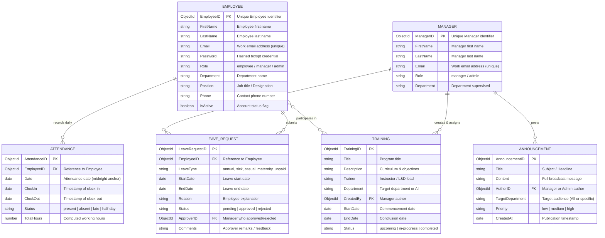

# ER-DIAGRAM

## Explanation of the HRM System ER Diagram

The **Entity-Relationship Diagram (ERD)** represents the core data structure of the **Human Resource Management System (HRM)**. It defines how various entities such as **Employee**, **Manager**, **LeaveRequest**, **Attendance**, and **Announcement** are related.

### 1. Employee Entity
- **Attributes**: `EmployeeID`, `FirstName`, `LastName`
- Each employee can **submit** multiple leave requests and has associated attendance records.

### 2. Manager Entity
- **Attributes**: `ManagerID`, `FirstName`, `LastName`
- A manager can **approve** leave requests submitted by employees and can also **post** announcements for the organization.

### 3. LeaveRequest Entity
- **Attributes**: `StartDate`, `EndDate`, `Status`
- Represents a leave application submitted by an employee and approved or rejected by a manager.

### 4. Attendance Entity
- **Attribute**: `Date`
- Keeps track of the daily attendance records of each employee.

### 5. Announcement Entity
- Represents organization-wide news or updates posted by managers or HR personnel.

---

## Relationships

- **Employee → LeaveRequest**: An employee submits a leave request.
- **Manager → LeaveRequest**: A manager approves or rejects a leave request.
- **Manager → Announcement**: A manager posts announcements for employees.
- **Employee → Attendance**: An employee records attendance daily.

---

## Detailed Schema & Entity Attributes

### Relational Matrix

| Source Entity | Relationship Verb | Target Entity | Cardinality | Business Rule |
|---|---|---|---|---|
| **Employee** | Submits | **LeaveRequest** | 1 to Many (1:N) | An employee can submit multiple leave requests over time. |
| **Manager** | Approves / Rejects | **LeaveRequest** | 1 to Many (1:N) | A manager reviews and approves/rejects leave requests submitted by employees. |
| **Manager** | Posts | **Announcement** | 1 to Many (1:N) | A manager publishes announcements for organizational communication. |
| **Employee** | Records | **Attendance** | 1 to Many (1:N) | An employee records daily attendance with clock-in and clock-out entries. |
| **Manager** | Assigns | **Training** | 1 to Many (1:N) | Managers create and assign professional development programs. |
| **Employee** | Participates in | **Training** | Many to Many (N:M) | Employees enroll in or are assigned to multiple training modules. |

---

## Interactive Mermaid ER Diagram

---

## Codebase Implementation Mapping

In the StaffSync codebase, these entities are implemented with clean schema definitions and virtual properties in [`server/src/models`](./server/src/models):
- [`User.js`](./server/src/models/User.js): Implements `Employee` and `Manager` entities with polymorphic `role` enum (`employee`, `manager`, `admin`), along with virtual accessors for `firstName`, `lastName`, `EmployeeID`, and `ManagerID`.
- [`LeaveRequest.js`](./server/src/models/LeaveRequest.js): Implements the leave request entity with references to `user` (Employee) and `approver` (Manager).
- [`Attendance.js`](./server/src/models/Attendance.js): Implements daily attendance records tied to Employee with automatic duration computations.
- [`Announcement.js`](./server/src/models/Announcement.js): Implements company-wide announcements with author attribution and priority flags.
- [`Training.js`](./server/src/models/Training.js): Implements training & development programs with assigned employees and lifecycle tracking.
