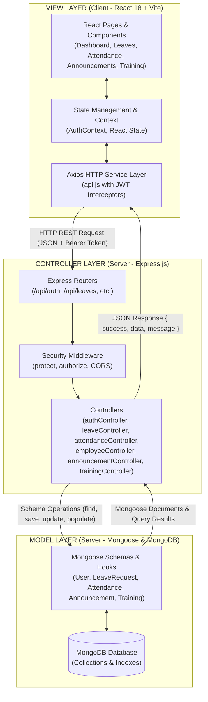
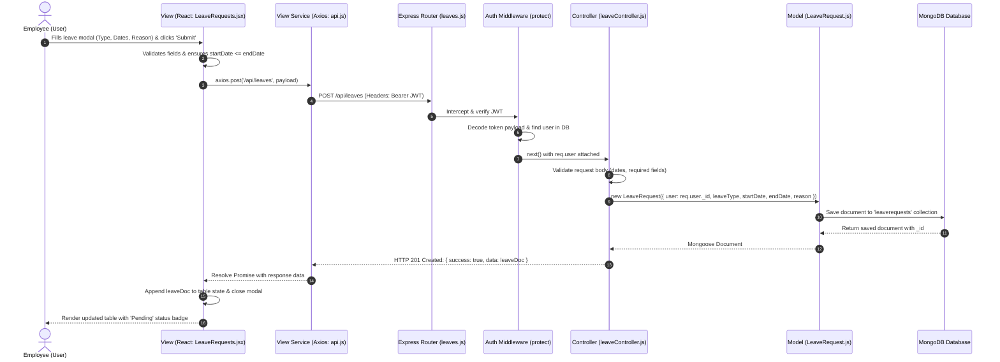

# MVC Pattern Architecture: StaffSync HRM Platform

The canonical document is maintained at [`docs/MVC_PATTERN.md`](./docs/MVC_PATTERN.md).

This document provides a comprehensive architectural breakdown of the **Model-View-Controller (MVC)** architectural design pattern as implemented in the **StaffSync Human Resource Management (HRM)** platform.

---

## 1. Architectural Concept: MVC in Modern Full-Stack MERN

In StaffSync, the traditional MVC paradigm is adapted for a decoupled, high-performance modern web architecture:

- **Model (M)**: Mongoose schemas, document models, lifecycle hooks, and database business rules residing in [`server/src/models/`](./server/src/models/).
- **View (V)**: The reactive frontend user interface built with React 18, Vite, and Tailwind CSS residing in [`client/src/`](./client/src/), managing presentation, user inputs, and local state.
- **Controller (C)**: The Express.js business logic orchestration layer residing in [`server/src/controllers/`](./server/src/controllers/), processing REST API requests, validating inputs, executing domain workflows, and returning standardized JSON responses.



---

## 2. Model Layer (Data & Domain Rules)

Location: [`server/src/models/`](./server/src/models/)

The Model layer defines the data structures, attribute constraints, relationships, encryption hooks, and virtual accessors:

### 1. `User.js` (User & Workforce Model)
- **Attributes**: `name`, `email` (unique, lowercase, trimmed), `password` (bcrypt hashed), `role` (`employee`, `manager`, `admin`), `department`, `position`, `phone`, `isActive`.
- **Pre-Save Hook**: Automatically intercepts password changes and hashes plain text passwords using `bcrypt.genSalt(10)` and `bcrypt.hash()` before saving.
- **Virtual Getters**:
  - `firstName` & `lastName`: Splits `name` into individual components for standardized ER attribute compliance.
  - `EmployeeID`: Aliases `_id` for employee representations.
  - `ManagerID`: Aliases `_id` when user has manager or admin roles.
- **Instance Methods**: `matchPassword(enteredPassword)` compares incoming passwords against the hashed record using `bcrypt.compare`.

### 2. `LeaveRequest.js` (Leave Application Model)
- **Attributes**: `user` (ObjectId ref to `User`), `leaveType` (`annual`, `sick`, `casual`, `maternity`, `unpaid`, `other`), `startDate` (Date), `endDate` (Date), `reason` (String), `status` (`pending`, `approved`, `rejected`), `approver` (ObjectId ref to `User`), `comments` (String).
- **Domain Rules**: Default status is always `pending`. Automatically timestamps creation and updates.

### 3. `Attendance.js` (Daily Attendance Model)
- **Attributes**: `user` (ObjectId ref to `User`), `date` (Date, normalized to midnight), `clockIn` (Date timestamp), `clockOut` (Date timestamp), `status` (`present`, `late`, `half-day`, `absent`), `totalHours` (Number, calculated duration).
- **Domain Rules**: Only one record permitted per employee per calendar date. Automatic status calculation flags check-ins after 09:30 AM as `late`.

### 4. `Announcement.js` (Company Notices Model)
- **Attributes**: `title` (String), `content` (String), `author` (ObjectId ref to `User`), `targetDepartment` (String, default `'All'`), `priority` (`low`, `medium`, `high`).
- **Domain Rules**: Timestamps publication date and tracks author attribution for administrative transparency.

### 5. `Training.js` (Training & Development Model)
- **Attributes**: `title` (String), `description` (String), `trainer` (String), `department` (String), `createdBy` (ObjectId ref to `User`), `startDate` (Date), `endDate` (Date), `status` (`upcoming`, `in-progress`, `completed`), `participants` (Array of ObjectId refs to `User`).

---

## 3. View Layer (Reactive User Interface)

Location: [`client/src/`](./client/src/)

The View layer provides a responsive, accessible single-page application (SPA) presenting real-time business data to end users:

```
client/src/
├── components/          # Reusable presentation and layout components
│   ├── Layout.jsx       # Global application shell with Sidebar and Navbar
│   ├── Navbar.jsx       # Header with user identity, notifications, profile trigger
│   ├── Sidebar.jsx      # Navigation links dynamically filtered by user role
│   └── ProfileModal.jsx # Interactive self-service profile and credential editor
├── pages/               # Primary domain views
│   ├── Dashboard.jsx    # Role-tailored dashboard (Admin metrics vs. Employee self-service)
│   ├── Employees.jsx    # Workforce roster table, search, filter, and add modal
│   ├── LeaveRequests.jsx# Leave submission modal, personal history, manager approval queue
│   ├── Attendance.jsx   # Interactive clock-in/out widget, status tags, history log
│   ├── Announcements.jsx# Company bulletin feed and priority-tagged notice creator
│   ├── Training.jsx     # Course catalog, registration, milestone indicators
│   ├── Login.jsx        # Secure login form with validation and demo quick-fill
│   └── Register.jsx     # Registration form with department and role selection
├── context/             # Client-side state orchestration
│   └── AuthContext.jsx  # Global authentication context, JWT persistence, user profile
└── services/            # Centralized API communication layer
    └── api.js           # Axios instance with request and response interceptors
```

### View Responsibilities:
1. **Dynamic Rendering**: Translates backend JSON models into interactive UI components (tables, badges, modal dialogs, metrics cards).
2. **Client Validation**: Validates user form inputs (email formatting, date ranges, required fields) before initiating network dispatches.
3. **Session Interception**: Transparently appends `Authorization: Bearer <token>` headers to all outgoing requests and gracefully handles token invalidation.

---

## 4. Controller Layer (Business Logic & Orchestration)

Location: [`server/src/controllers/`](./server/src/controllers/)

The Controller layer contains the discrete handlers responsible for interpreting HTTP requests, invoking Model methods, applying business rules, and sending standardized HTTP responses:

```
server/src/controllers/
├── authController.js        # Authentication & Profile orchestration
├── employeeController.js    # Workforce directory & account administration
├── leaveController.js       # Leave application & approval workflows
├── attendanceController.js  # Clock-in/out processing & hours calculation
├── announcementController.js# Notice authoring & organizational feeds
└── trainingController.js    # Training program lifecycle & assignments
```

### Controller Responsibilities & Endpoints:

#### 1. `authController.js`
- `register`: Validates user inputs, checks for duplicate emails, creates `User` model document, issues signed JWT token.
- `login`: Verifies user existence, checks password with `bcrypt.compare`, issues signed JWT token with user role and profile payload.
- `getMe`: Returns currently authenticated user details extracted from `req.user`.
- `updateProfile`: Updates personal phone, department, or re-hashes and persists a new password.

#### 2. `employeeController.js`
- `getEmployees`: Fetches all workforce records, allowing optional query filtering by department or role.
- `getEmployeeById`: Fetches specific employee profile details; returns 404 if not found.
- `createEmployee`: HR/Admin-only endpoint for provisioning new workforce accounts.
- `updateEmployee`: Updates job position, department, contact info, or active status.
- `deleteEmployee`: Deactivates or removes employee accounts cleanly.

#### 3. `leaveController.js`
- `getLeaves`: Role-sensitive retrieval: Employees receive only their personal leaves; Managers and Admins receive all leaves across the organization.
- `createLeave`: Enforces date validation, sets initial status to `pending`, and links document to applicant.
- `updateLeaveStatus`: Manager/Admin-only endpoint to transition status to `approved` or `rejected`, recording approver ID and comments.

#### 4. `attendanceController.js`
- `clockIn`: Validates date; prevents duplicate clock-in for the same day; compares timestamp against 09:30 AM to flag status as `late` or `present`.
- `clockOut`: Retrieves existing active check-in for current date; computes total hours elapsed; records `clockOut` timestamp.
- `getAttendance`: Returns historical attendance logs (own records for employees; organization-wide for managers/admins).
- `getTodayAttendance`: Fast lookup returning today's active shift status for the current user.

#### 5. `announcementController.js`
- `getAnnouncements`: Fetches chronological notices, populating author names and formatting target audiences.
- `createAnnouncement`: Manager/Admin-only endpoint to persist announcements with priority tags.

#### 6. `trainingController.js`
- `getTrainings`: Retrieves courses matching target department or general availability.
- `createTraining`: Manager/Admin-only endpoint to structure course objectives, dates, and assignees.
- `updateTraining`: Updates syllabus, progress, or marks training as completed.
- `deleteTraining`: Removes concluded or cancelled training programs.

---

## 5. Controller Gateways: Routes & Middleware

Location: [`server/src/routes/`](./server/src/routes/) and [`server/src/middleware/`](./server/src/middleware/)

Routes act as the traffic controller mapping RESTful URIs and HTTP verbs directly to Controller functions, protected by security middleware:

```mermaid
flowchart LR
    Incoming[Incoming HTTP Request] --> RouteMatcher{Match Route Pattern}
    
    RouteMatcher --> /api/auth --> AuthRoutes[auth.js]
    RouteMatcher --> /api/employees --> EmpRoutes[employees.js]
    RouteMatcher --> /api/leaves --> LeaveRoutes[leaves.js]
    RouteMatcher --> /api/attendance --> AttRoutes[attendance.js]
    RouteMatcher --> /api/announcements --> AnnRoutes[announcements.js]
    RouteMatcher --> /api/training --> TrainRoutes[training.js]

    LeaveRoutes --> Protect[protect Middleware\n(Verify JWT & Attach req.user)]
    Protect --> AuthCheck{Route Requires Specific Role?}
    AuthCheck -- No --> LeaveCtrl[leaveController.createLeave]
    AuthCheck -- Yes (Manager/Admin) --> Authorize[authorize('manager', 'admin') Middleware]
    Authorize --> LeaveCtrlStatus[leaveController.updateLeaveStatus]
```

---

## 6. End-to-End MVC Request Lifecycle Sequence

The following sequence illustrates the complete MVC interaction loop during a representative operation: **An Employee Submitting a Leave Request**:



---

## 7. Architectural Benefits of MVC in StaffSync

| Architectural Attribute | Implementation in StaffSync | Key Benefit |
|---|---|---|
| **Separation of Concerns** | Strict decoupling between presentation (`client/`), business logic (`controllers/`), and schema definitions (`models/`). | Enables independent development, UI redesigns, and schema migrations without cascading regressions. |
| **Comprehensive Testability** | Controllers are decoupled from Express server startup and can be thoroughly tested via Supertest without a live browser. | 100% test coverage across authentication, authorization, business rules, and error handling. |
| **Maintainability** | Standardized folder structure and predictable code placement across all 6 core business domains. | New developers can onboard quickly and add features following identical architectural conventions. |
| **Robust Security** | Input validation occurs at the View (client), Controller (business rules), and Model (Mongoose schema) layers. | Eliminates injection vulnerabilities, enforces strong cryptographic standards, and guarantees role boundary isolation. |
