# StaffSync - Modern Human Resource Management Solution

StaffSync is an enterprise-grade full-stack MERN application for Human Resource and Employee Management, featuring Role-Based Access Control (Admin, Manager, Employee), Leave Management, Attendance Tracking, Announcements, Training & Development, and an analytics dashboard.

---

## 📚 Project Architecture & Documentation

Comprehensive architectural design and engineering documentation are maintained in the [`docs/`](./docs) directory:

- [**Technical Architecture**](./docs/TECHNICAL_ARCHITECTURE.md): System topology, MERN stack specifications, dual-mode persistence strategy, and security model.
- [**Entity-Relationship Diagram (ERD)**](./docs/ER_DIAGRAM.md): Full data schema, entities (`Employee`, `Manager`, `LeaveRequest`, `Attendance`, `Announcement`, `Training`), relationships, and interactive Mermaid & SVG diagrams.
- [**System Features Specification**](./docs/FEATURES.md): Deep-dive into Role-Based Access Control, Employee & Leave Management, Attendance Tracking & Reporting, and Internal Announcements.
- [**Roles and Responsibilities**](./docs/ROLES_AND_RESPONSIBILITIES.md): Operational breakdown of the 7 core responsibilities across HR, Managers, Employees, and System Architecture.
- [**User Flows**](./docs/USER_FLOW.md): End-to-end journey maps and Mermaid flowcharts for authentication, leaves, attendance, announcements, and training.
- [**MVC Pattern Architecture**](./docs/MVC_PATTERN.md): Exhaustive breakdown of Model, View, and Controller layers, sequence diagrams, and MERN separation of concerns.
- [**Comprehensive Project Architecture Blueprint**](./docs/PROJECT_ARCHITECTURE.md): Master blueprint consolidating all architecture modules into an integrated guide.

---

## 📊 Entity Relationship Overview

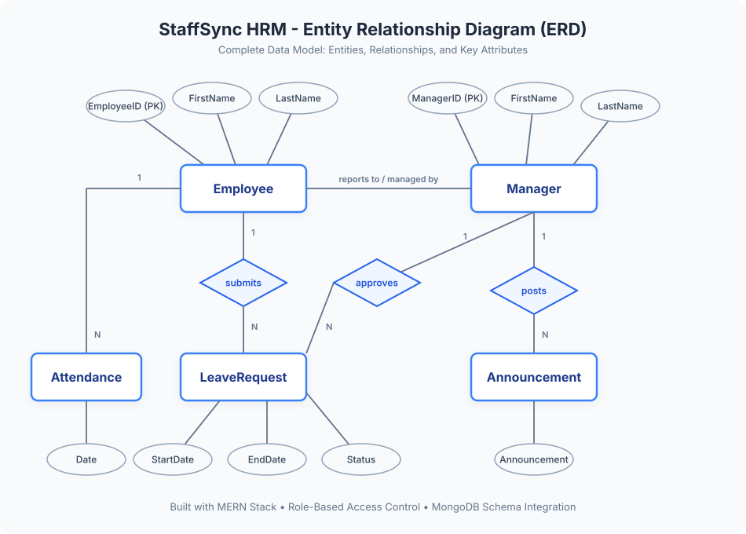

---

## 📸 Application UI Showcase

### 1. Operations Dashboard
Real-time KPI metrics, personal shift clock-in widget, leave requests overview, and quick-action directory links:
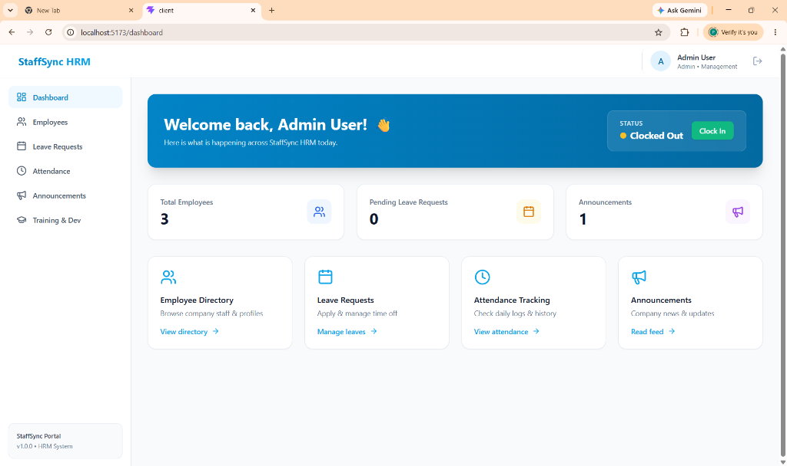

### 2. Employee Directory & Roster
Searchable personnel cards filtered by department with role badges and contact information:
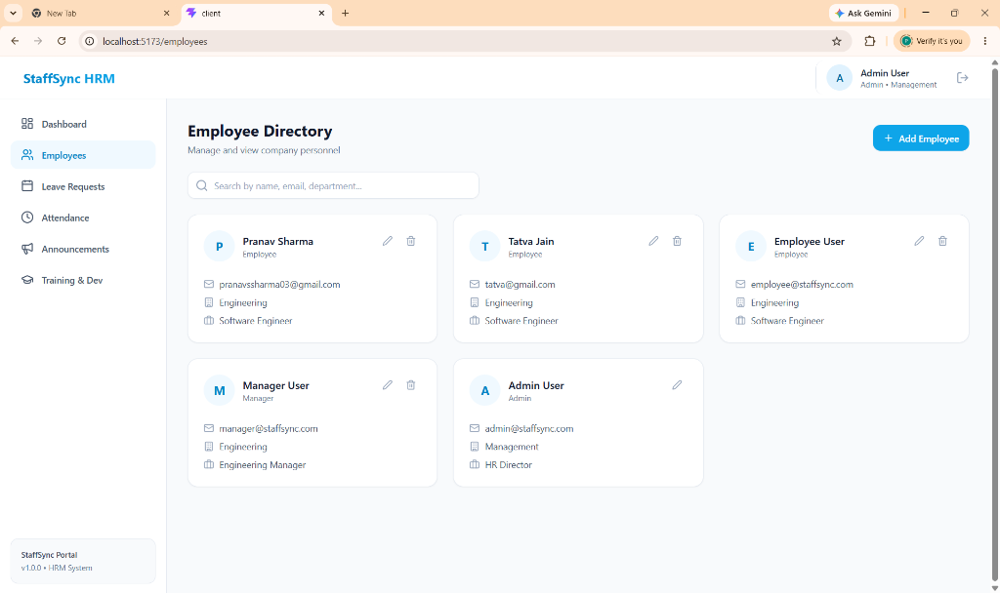

### 3. Provisioning New Workforce Accounts
HR administrator modal for creating new employee profiles with role assignment:
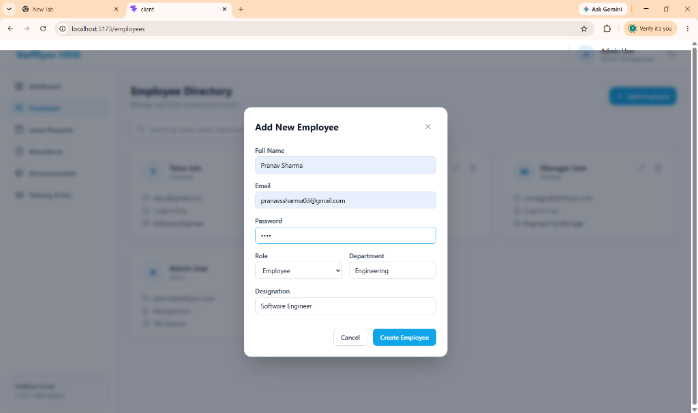

### 4. Digital Leave Management
Intuitive time-off request application with leave type categorization and automated manager queueing:
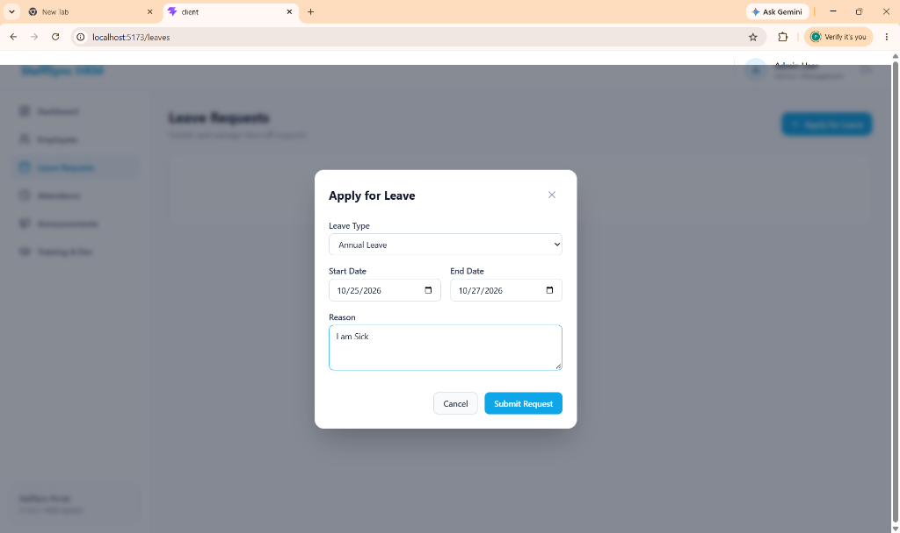

### 5. Real-Time Attendance & Punctuality Tracking
Daily clock-in/out timestamps, active shift tracking, automated hours calculation, and arrival lateness status badges:
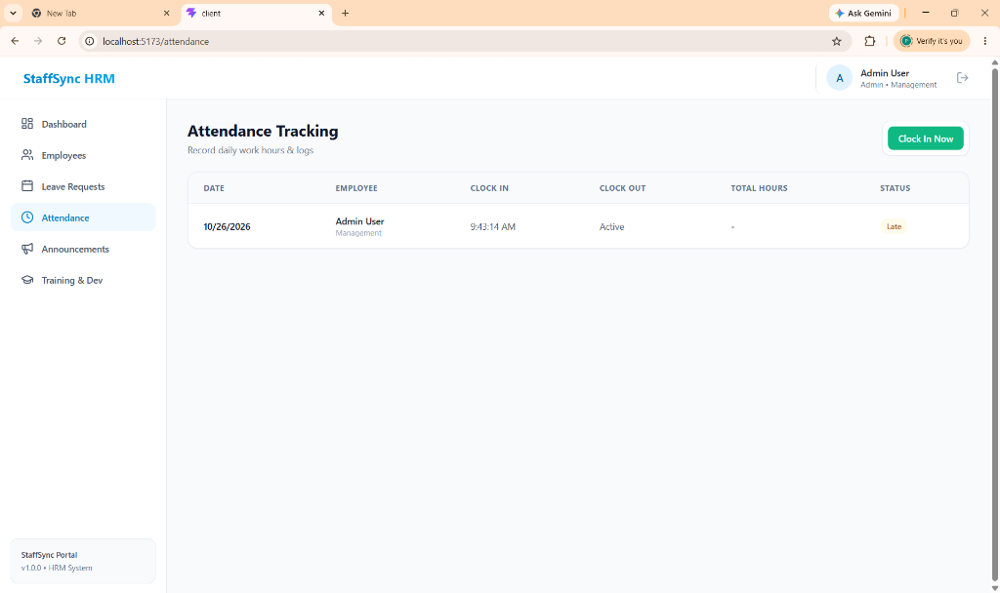

### 6. Company Announcements Publishing
Modal form enabling managers and administrators to draft and publish organization-wide notices:
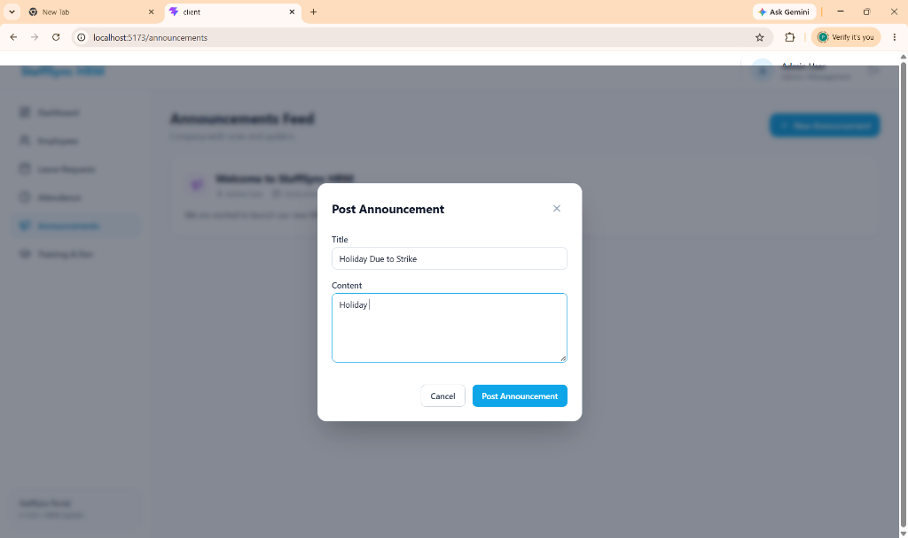

### 7. Internal Announcements Bulletin Feed
Live chronological feed keeping personnel informed on operational schedules, strikes, and holidays:
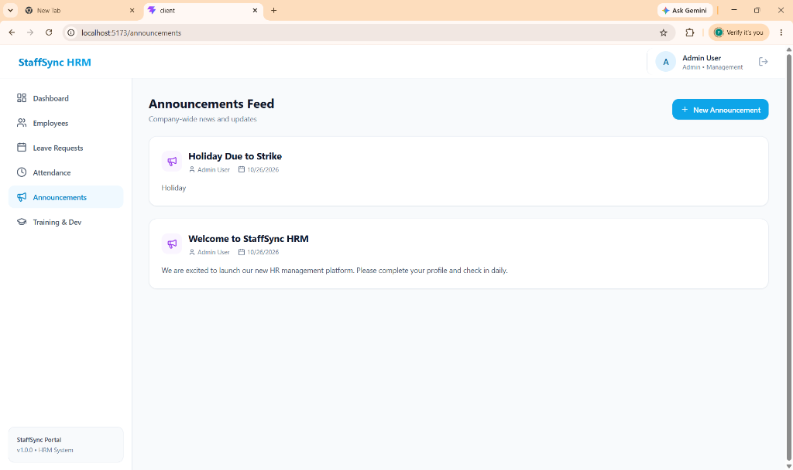

### 8. Creating Professional Development Programs
Course curriculum definition modal with trainer assignment and target department routing:
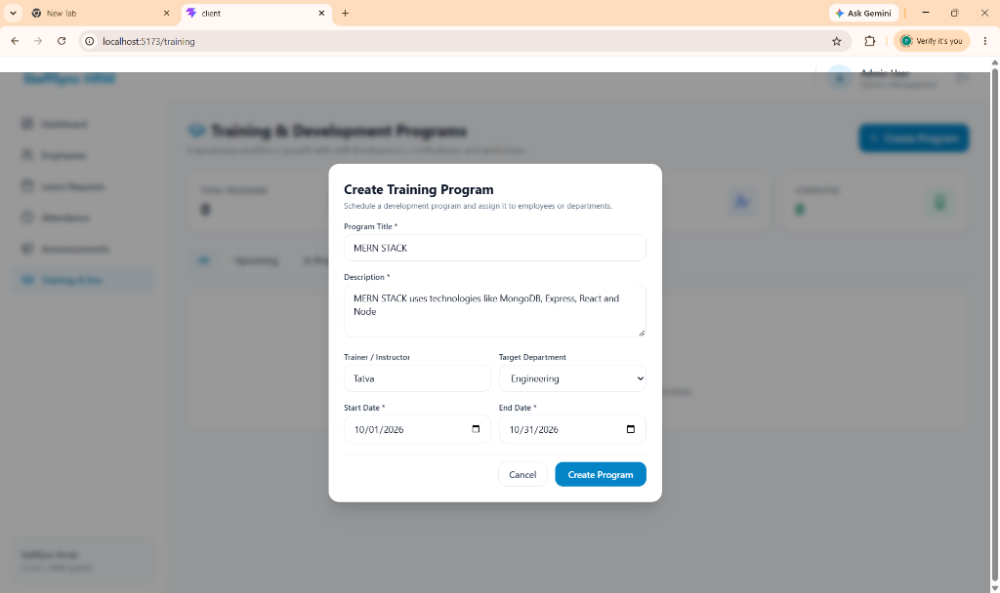

### 9. Training Programs & Skill Development Catalog
Interactive course catalog with lifecycle indicators and department filtering:
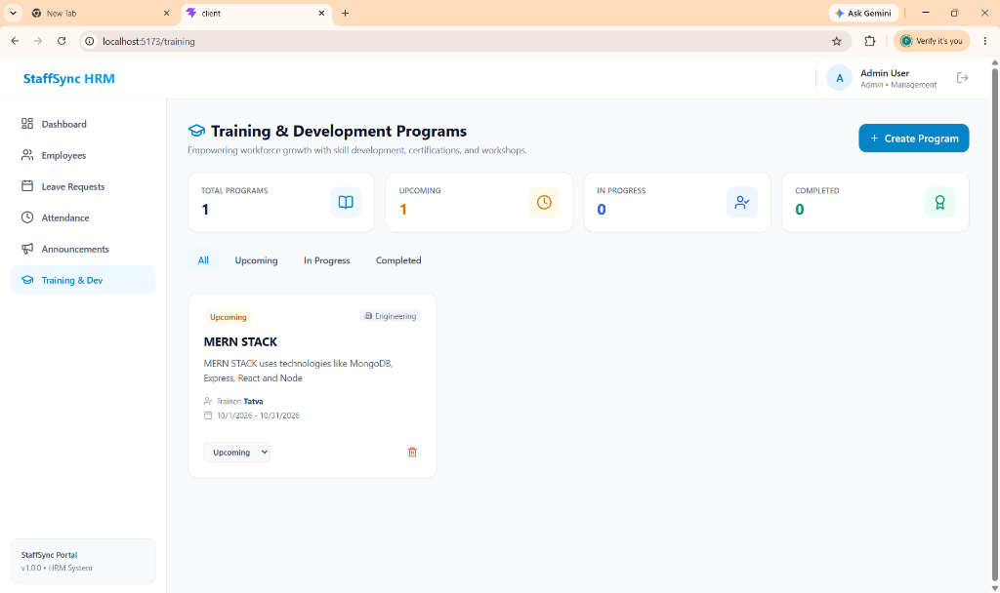

### 10. Processed Leave Ledger & Approval Audit
Employee time-off records showing date durations, justifications, and managerial approval status:
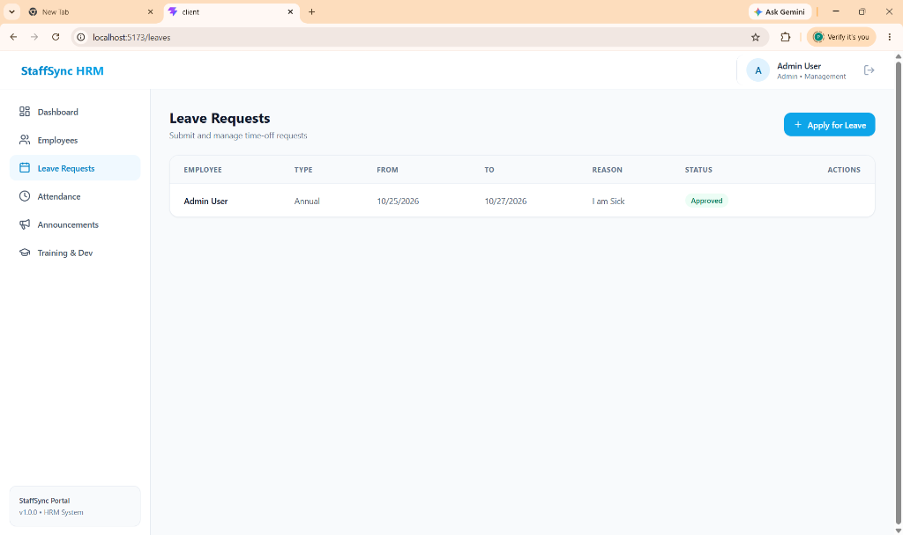

---

## 🚀 Quick Start

### 1. Running Both Services

You can launch both server and client together by double-clicking `start.bat` or running:

```powershell
# In one terminal (Backend):
cd server
npm start

# In another terminal (Frontend):
cd client
npm run dev
```

- **Frontend App**: [http://localhost:5173](http://localhost:5173)
- **Backend API**: [http://localhost:5000](http://localhost:5000)

---

## 🔑 Pre-seeded Demo Accounts

| Role | Email | Password | Permissions |
|---|---|---|---|
| **Admin** | `admin@staffsync.com` | `Password123!` | Full organization management, user creation, deactivations, announcements |
| **Manager** | `manager@staffsync.com` | `Password123!` | Team supervision, leave approvals, training creation, announcements |
| **Employee** | `employee@staffsync.com` | `Password123!` | Attendance clock-in/out, leave applications, training participation, profile updates |

---

## 🧪 Running Automated Tests

To run the comprehensive backend automated test suite:

```powershell
cd server
npm test
```

All 27 automated tests validate:
1. Auth Registration & Login
2. RBAC (Role-Based Access Control)
3. Leave Request Submission & Approval Workflow
4. Attendance Clock-In/Out Logic & Lateness Evaluation
5. Input Validation & Security Protections
6. Training Programs & Personal Profile Updates
