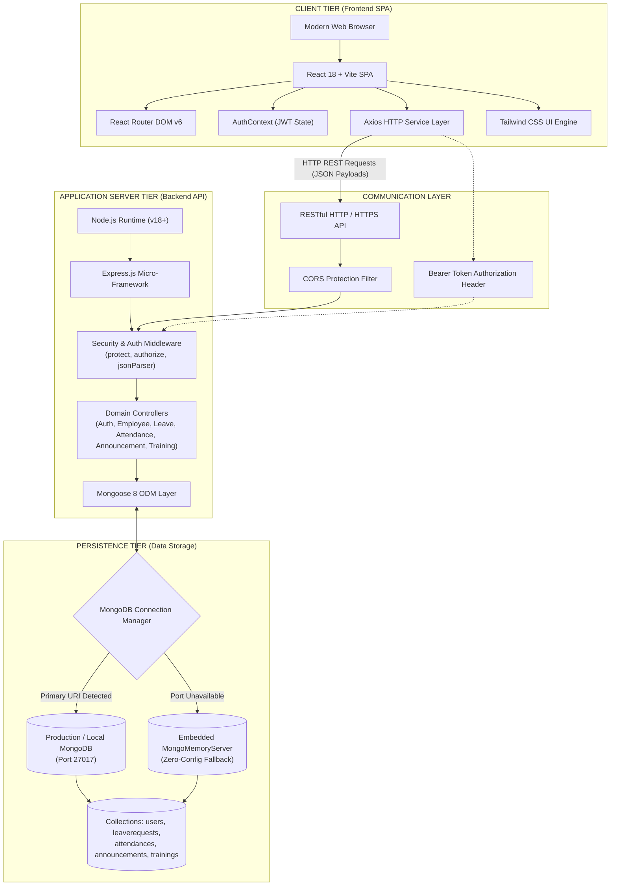

# Technical Architecture Specification: StaffSync HRM Platform

The canonical document is maintained at [`docs/TECHNICAL_ARCHITECTURE.md`](./docs/TECHNICAL_ARCHITECTURE.md).

This document defines the comprehensive **Technical Architecture** for the **StaffSync Human Resource Management (HRM)** platform, detailing the system topology, tech stack specifications, communication protocols, database persistence strategy, and security framework.

---

## 1. High-Level Architectural Topology

StaffSync is architected as an enterprise-grade, decoupled full-stack web application built upon the **MERN** (MongoDB, Express.js, React, Node.js) technology stack:

---

## 2. Frontend Architecture (Client Tier)

The frontend is constructed as a responsive Single-Page Application (SPA) designed for rapid interaction, smooth transitions, and distinct role-based experiences.

### Key Technology Stack:
- **Core Library**: **React 18.2** leveraging functional components, custom hooks, and concurrent rendering features.
- **Build Tool & Bundler**: **Vite 5** providing lightning-fast Hot Module Replacement (HMR) and optimized production tree-shaking.
- **Client Routing**: **React Router DOM v6** for declarative client-side routing, nested layouts, and route protection guards.
- **Styling & Design System**: **Tailwind CSS 3** providing a utility-first, modern design system with curated slate/blue color palettes, responsive flex/grid layouts, and clean typography.
- **Iconography**: **Lucide React** for high-clarity, accessible SVG iconography.
- **HTTP Client**: **Axios 1.6** configured with a centralized interceptor architecture:
  - Automatically injects `Authorization: Bearer <token>` on all outgoing authenticated requests.
  - Intercepts 401 Unauthorized responses to purge expired tokens and redirect seamlessly to the login screen.
- **State Management**: **React Context API (`AuthContext`)** managing global authentication state, token persistence in `localStorage`, and active user identity.

---

## 3. Backend Architecture (Server Tier)

The server tier is structured following a layered Controller-Service architectural pattern built on Node.js and Express.

### Key Technology Stack:
- **Runtime Environment**: **Node.js** (LTS v18/v20).
- **Web Framework**: **Express.js 4.19** providing a robust HTTP pipeline, middleware chain, and RESTful routing.
- **Authentication Engine**: **JSON Web Tokens (jsonwebtoken 9.0)** generating cryptographically signed, stateless session tokens.
- **Cryptographic Security**: **Bcrypt.js 2.4** executing secure password hashing using 10 salt rounds.
- **Cross-Origin Security**: **Cors 2.8** configured for seamless, secure multi-origin resource sharing between client and server ports.
- **Environment Configuration**: **Dotenv 16.4** decoupling runtime secrets, ports, and connection strings from source code.

---

## 4. Database Architecture & Resilience Strategy

The persistence layer uses MongoDB combined with Mongoose 8 for strict schema enforcement, virtual properties, and lifecycle hooks.

### High-Availability & Zero-Config Resilience
A unique architectural advantage of StaffSync is its **Dual-Mode Persistence Strategy**:
1. **Standard Mode**: Connects directly to any standalone MongoDB instance or cloud replica set (`mongodb://127.0.0.1:27017/staffsync` or MongoDB Atlas URI).
2. **Autonomous Zero-Config Fallback**: If a local MongoDB daemon is not detected on port 27017, the server automatically spawns an in-memory **Embedded `MongoMemoryServer`**.
3. **Automated Seeding Pipeline**: Upon database initialization, if the user collection is empty, the server automatically seeds default demo accounts (`admin@staffsync.com`, `manager@staffsync.com`, `employee@staffsync.com`), ensuring the platform runs out-of-the-box without manual database setup.

---

## 5. Security & RBAC Architecture

### 1. Role-Based Access Control (RBAC) Matrix
The platform implements a multi-tier authorization hierarchy enforced at both the API and client routes:

| Role | Permissions & Operational Scope |
|---|---|
| **Admin** | Full organizational control; provision, edit, and deactivate employee accounts; configure system announcements; oversee company-wide attendance and leave balances. |
| **Manager** | Departmental supervision; review, approve, or reject employee leave requests; publish company and departmental notices; create and assign training programs. |
| **Employee** | Self-service capabilities; record daily attendance clock-in/out; apply for leaves; review own history; update personal contact info and security credentials. |

### 2. Multi-Layer Guard Pipeline
- **Layer 1: Frontend Route Guards (`ProtectedRoute`)**: Prevents unauthenticated users from accessing internal routes.
- **Layer 2: Token Verification (`protect` middleware)**: Decodes JWT from `Authorization: Bearer <token>`, validates signature against `JWT_SECRET`, and attaches the verified user model to `req.user`.
- **Layer 3: Privilege Authorization (`authorize('admin', 'manager')`)**: Blocks operations if `req.user.role` lacks required privilege, returning HTTP 403 Forbidden.

---

## 6. Automated Testing & Verification Infrastructure

StaffSync includes an end-to-end automated test suite built with **Jest** and **Supertest**:
- **Isolated In-Memory Test Server**: Uses isolated `MongoMemoryServer` instances, ensuring test isolation without side effects on development data.
- **Test Coverage**: 27 automated tests validating authentication, RBAC boundaries, leave lifecycles, attendance punctuality and duration calculations, input validation, and training programs.
- **Test Execution**: Run via `npm test` from the `server/` directory.
