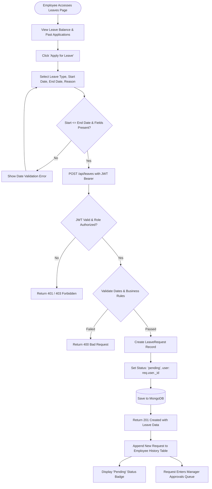
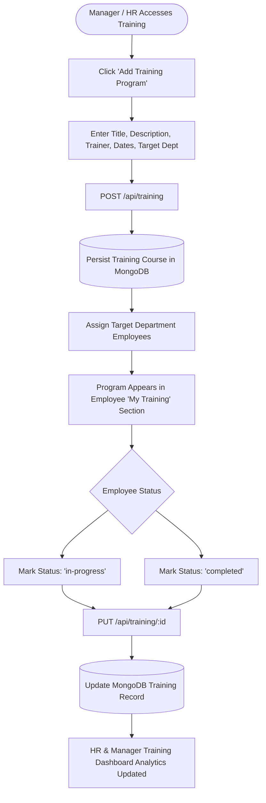
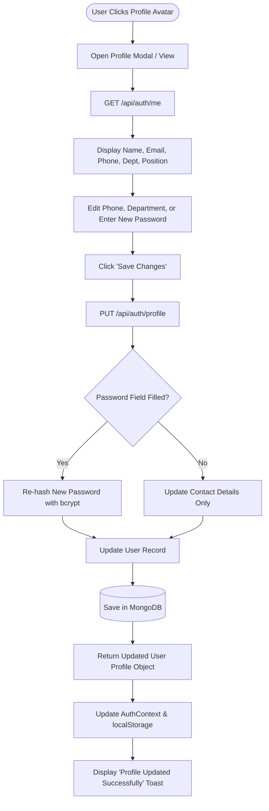

# User Flow Architecture: StaffSync HRM Platform

The canonical document is maintained at [`docs/USER_FLOW.md`](./docs/USER_FLOW.md).

This document outlines the end-to-end **User Flows** and operational interaction models for the **StaffSync Human Resource Management (HRM)** platform. It details user journeys across all three role tiers: **Employee**, **Manager**, and **Admin / HR Personnel**.

---

## 1. High-Level User Journey Overview

StaffSync structures user interactions into 7 principal lifecycle flows:
1. **Authentication & Role-Based Redirection Flow**
2. **Employee Leave Application Flow**
3. **Manager Leave Review & Decision Flow**
4. **Daily Attendance Clock-In / Clock-Out Flow**
5. **Announcement Publishing & Broadcast Flow**
6. **Training Program Creation & Participation Flow**
7. **Employee Profile & Credential Self-Service Flow**

---

## 2. Detailed User Flows with Mermaid Diagrams

### Flow 1: Authentication, Registration & Role-Based Routing

This flow governs how visitors register, authenticate, acquire stateless JSON Web Tokens (JWT), and are dynamically redirected to their role-specific dashboard interface.

```mermaid
flowchart TD
    Start([User Arrives at Platform]) --> CheckAuth{Has Valid Session Token?}
    
    CheckAuth -- Yes --> AutoVerify[Verify JWT Expiration & Signature]
    AutoVerify -- Valid Token --> RouteRole{Check User Role}
    AutoVerify -- Expired / Invalid --> ClearToken[Clear Token & Redirect to /login]
    
    CheckAuth -- No --> LoginPage[Navigate to /login]
    LoginPage --> HasAccount{Existing Account?}
    
    HasAccount -- No --> RegPage[Navigate to /register]
    RegPage --> RegInput[Enter Name, Email, Password, Role, Dept]
    RegInput --> RegValidate{Validation Passed?}
    RegValidate -- No --> RegErr[Display Inline Form Errors]
    RegErr --> RegPage
    RegValidate -- Yes --> RegAPI[POST /api/auth/register]
    RegAPI --> HashBcrypt[Hash Password with bcrypt (10 rounds)]
    HashBcrypt --> SaveUser[Persist User Record in MongoDB]
    SaveUser --> ReturnAuth[Return JWT Token & User Profile]
    ReturnAuth --> StoreLocal[Store Token & User in localStorage]
    
    HasAccount -- Yes --> EnterCreds[Enter Email & Password]
    EnterCreds --> SubmitLogin[POST /api/auth/login]
    SubmitLogin --> FindUser{User Exists & Active?}
    FindUser -- No --> AuthErr[Display 401 Invalid Credentials]
    FindUser -- Yes --> ComparePass{bcrypt.compare Valid?}
    ComparePass -- No --> AuthErr
    ComparePass -- Yes --> GenJWT[Generate JWT Token]
    GenJWT --> ReturnAuth
    
    StoreLocal --> RouteRole
    RouteRole -- Admin / HR --> AdminView[Admin Operations Dashboard]
    RouteRole -- Manager --> MgrView[Manager Department Dashboard]
    RouteRole -- Employee --> EmpView[Employee Self-Service Portal]
```

---

### Flow 2: Employee Leave Application Flow



---

### Flow 3: Manager Leave Review & Decision Flow

```mermaid
flowchart TD
    MgrStart([Manager Navigates to Leaves Hub]) --> FetchPending[GET /api/leaves - Filtered by Pending]
    FetchPending --> RenderList[Render Requests with Employee Name, Dates, Reason]
    
    RenderList --> SelectReq[Manager Selects Request for Review]
    SelectReq --> EvalStaffing{Assess Department Coverage}
    
    EvalStaffing --> DecisionBranch{Manager Decision}
    
    DecisionBranch -- Approve --> ClickApprove[Click 'Approve' Button]
    ClickApprove --> AddApproveComments[Optional: Enter Approval Comments]
    AddApproveComments --> SendApproveAPI[PUT /api/leaves/:id/status\nBody: { status: 'approved', comments }]
    
    DecisionBranch -- Reject --> ClickReject[Click 'Reject' Button]
    ClickReject --> AddRejectReason[Mandatory: Enter Rejection Reason]
    AddRejectReason --> SendRejectAPI[PUT /api/leaves/:id/status\nBody: { status: 'rejected', comments }]
    
    SendApproveAPI --> VerifyRole{Is Manager or Admin?}
    SendRejectAPI --> VerifyRole
    
    VerifyRole -- No --> Err403[Return 403 Access Denied]
    VerifyRole -- Yes --> UpdateRecord[Update Leave: approver = manager._id, status, comments]
    UpdateRecord --> SaveDB[(Update MongoDB Document)]
    
    SaveDB --> SuccessRes[Return 200 with Updated Leave Object]
    SuccessRes --> UpdateManagerUI[Remove from Pending Queue / Update Badge]
    UpdateManagerUI --> RefreshedInEmpPortal[Instantly Reflected in Employee Portal]
```

---

### Flow 4: Daily Attendance Clock-In & Clock-Out Flow

```mermaid
flowchart TD
    EmpArrival([Employee Arrives at Work / Shifts]) --> OpenAttendance[Navigate to Attendance Page]
    OpenAttendance --> FetchToday[GET /api/attendance/today]
    
    FetchToday --> CheckStatus{Has Clocked In Today?}
    
    CheckStatus -- No --> EnableClockIn[Clock In Button Active]
    EnableClockIn --> PressClockIn[Employee Clicks 'Clock In']
    PressClockIn --> PostClockIn[POST /api/attendance/clock-in]
    
    PostClockIn --> CheckDuplicate{Existing Record for Today?}
    CheckDuplicate -- Yes --> RejectDup[Return 400: Already clocked in today]
    
    CheckDuplicate -- No --> CheckTime{Current Time > 09:30 AM?}
    CheckTime -- Yes --> FlagLate[Set status: 'late']
    CheckTime -- No --> FlagPresent[Set status: 'present']
    
    FlagLate --> SaveInRecord[Save Record: date, clockIn = now(), status]
    FlagPresent --> SaveInRecord
    SaveInRecord --> SaveDB[(Persist in MongoDB)]
    SaveDB --> ShowActiveShift[UI: Show Clocked-In State & Active Timer]
    
    CheckStatus -- Yes --> CheckClockOut{Has Already Clocked Out?}
    CheckClockOut -- Yes --> ShowCompleted[UI: Shift Complete - Total Hours Logged]
    
    CheckClockOut -- No --> EnableClockOut[Clock Out Button Active]
    EnableClockOut --> PressClockOut[Employee Clicks 'Clock Out']
    PressClockOut --> PostClockOut[POST /api/attendance/clock-out]
    
    PostClockOut --> FetchExistingRec[Find Today's Record for User]
    FetchExistingRec --> CalcDiff[Compute Duration:\ntotalHours = (clockOut - clockIn) in hours]
    CalcDiff --> UpdateAttRec[Update Record: clockOut = now(), totalHours]
    UpdateAttRec --> SaveUpdatedDB[(Save to MongoDB)]
    SaveUpdatedDB --> UpdateUIAtt[UI: Display Total Working Hours & Completed Badge]
```

---

### Flow 5: Announcement Publishing & Organizational Broadcast Flow

```mermaid
flowchart TD
    AuthorStart([Manager / HR Opens Announcements]) --> ClickNew[Click 'Create Announcement']
    ClickNew --> OpenModal[Open Announcement Creator Modal]
    
    OpenModal --> FormFill[Enter Title, Content, Priority, Target Dept]
    FormFill --> ValidateForm{Title & Content Non-Empty?}
    ValidateForm -- No --> ShowErr[Highlight Required Fields]
    ShowErr --> FormFill
    
    ValidateForm -- Yes --> SubmitPost[POST /api/announcements]
    SubmitPost --> CheckPermissions{User Role: Admin or Manager?}
    CheckPermissions -- No --> Block403[403 Forbidden: Insufficient Permissions]
    
    CheckPermissions -- Yes --> TagAuthor[Attach author: req.user._id, createdAt: Date.now()]
    TagAuthor --> SaveAnnounce[(Insert into MongoDB Announcements)]
    
    SaveAnnounce --> BroadcastResponse[Return 201 Created]
    BroadcastResponse --> UpdateFeed[Real-Time Update on Company Notice Board]
    UpdateFeed --> EmpRead[Visible on All Eligible Employee Dashboards]
```

---

### Flow 6: Training Program Creation & Assignment Flow



---

### Flow 7: Employee Profile & Credential Self-Service Flow



---

## 3. Cross-Functional State Transition Matrix

| Entity | Initial State | Triggering Event | Intermediate State | Terminal State | Accessible Roles |
|---|---|---|---|---|---|
| **LeaveRequest** | None | Submit Leave Form | `pending` | `approved` or `rejected` | Employee (create), Manager / Admin (decide) |
| **Attendance** | None | Clock In Action | `present` / `late` | Completed (Total Hours Calculated) | Employee (mark), All (view) |
| **User Account** | Registration | Admin Approval / Verification | `active` | `inactive` (Deactivated) | Admin (full control), Employee (self-edit) |
| **Training** | Draft | Program Scheduled | `upcoming` | `in-progress` ➔ `completed` | Manager (create), Employee (participate) |
| **Announcement** | Draft | Publish Event | Published (`low` / `med` / `high`) | Archived / Removed | Manager / HR (author), All (read) |
