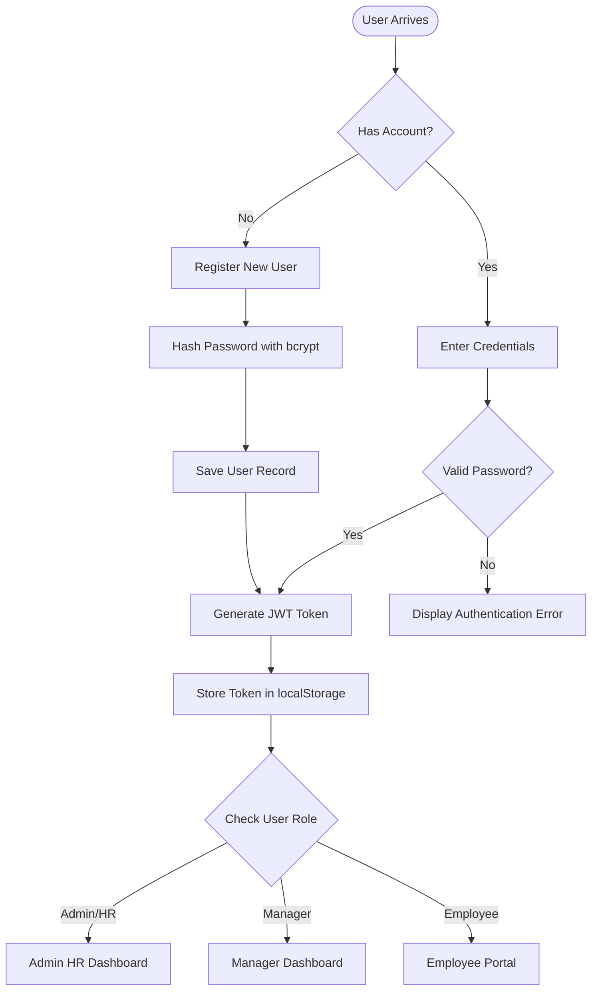
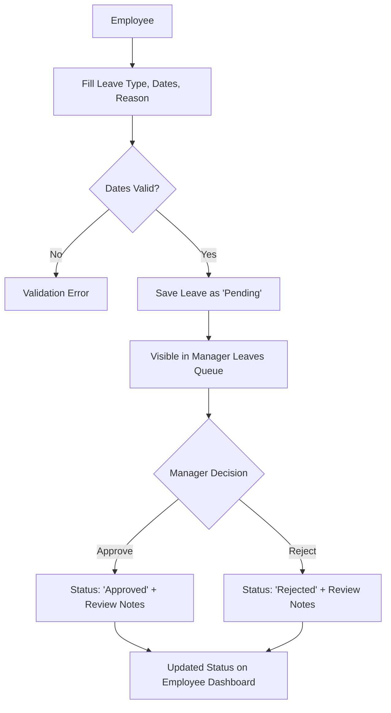
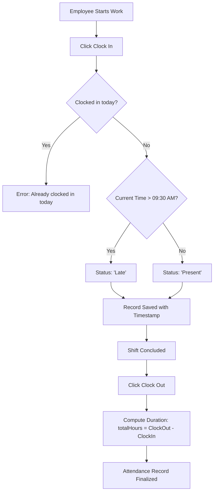

# Project Architecture: StaffSync HRM Platform

This document consolidates the complete architectural blueprint for **StaffSync**, covering Technical Architecture, Data Modeling, Feature Capabilities, Roles & Responsibilities, User Flows, and the MVC Pattern.

---

## 1. Technical Architecture

Comprehensive technical specifications and system topology are detailed in [**`docs/TECHNICAL_ARCHITECTURE.md`**](./TECHNICAL_ARCHITECTURE.md).

StaffSync is architected as a modern, decoupled full-stack application built upon the **MERN** stack:

```
[ React 18 + Vite + Tailwind CSS Frontend ]
                    │
                    ▼  (REST API / JWT over HTTP)
[ Express.js + Node.js Backend Server ]
                    │
                    ▼  (Mongoose ORM)
         [ MongoDB Database ]
```

### Technology Highlights
- **Frontend**:
  - React 18 with Vite for ultra-fast HMR and bundle optimization.
  - React Router DOM v6 for declarative client-side routing and protected routes.
  - Tailwind CSS for modern, responsive UI design.
  - Lucide React for consistent and accessible iconography.
  - Axios for centralized API calls with automatic JWT authorization header interceptors.
- **Backend**:
  - Express.js micro-framework with layered controller-service architecture.
  - Mongoose 8 for schema validation, hooks, and virtual properties.
  - JSON Web Tokens (JWT) for stateless, cryptographically signed user sessions.
  - Bcrypt.js for secure password hashing (10 salt rounds).
  - Embedded MongoDB Memory Server fallback for seamless local execution and test execution without external database setup.

---

## 2. ER-DIAGRAM (Data Modeling)

Complete relational and schema documentation is provided in [**`docs/ER_DIAGRAM.md`**](./ER_DIAGRAM.md) and illustrated below:


### Entities & Relationships
1. **Employee**: Identifiable by `EmployeeID`, `FirstName`, `LastName`. Submits leave applications and marks daily attendance.
2. **Manager**: Identifiable by `ManagerID`, `FirstName`, `LastName`. Approves/rejects leave requests, posts announcements, and assigns training courses.
3. **LeaveRequest**: Defined by `StartDate`, `EndDate`, and `Status` (`pending`, `approved`, `rejected`). Submitted by employee, resolved by manager.
4. **Attendance**: Daily time tracking with `Date`, `ClockIn`, `ClockOut`, status calculation (`present`, `late`), and total hours worked.
5. **Announcement**: Broadcast communication with `Title`, `Content`, author tracking, priority level, and departmental targeting.
6. **Training**: Development program tracking with `Title`, `Description`, `StartDate`, `EndDate`, instructor, and assigned participants.

---

## 3. Features Specification

Full feature details and permission matrix are documented in [**`docs/FEATURES.md`**](./FEATURES.md):
1. **Role-Based Access Control (RBAC)**: Distinct views, dashboards, and capabilities for Admin, Managers, and Employees.
2. **Employee & Leave Management**: Workforce roster administration and automated leave approval workflows.
3. **Attendance Tracking & Reporting**: Real-time clock-in/out, lateness detection, and analytics.
4. **Announcements & Internal Communication**: Priority-tagged broadcast system for company notifications.

---

## 4. Roles and Responsibilities

Operational guidelines are detailed in [**`docs/ROLES_AND_RESPONSIBILITIES.md`**](./ROLES_AND_RESPONSIBILITIES.md):
1. **Manage Employee Records Efficiently** (HR / Admin)
2. **Handle Leave Management Processes** (Employees, Managers, HR)
3. **Track and Monitor Attendance** (Employees, HR)
4. **Manage Training and Development Programs** (Managers, HR)
5. **Post and Review Announcements** (HR, Managers)
6. **Maintain Personal Employee Information** (Employees)
7. **Ensure Secure Access and Authentication** (System Architecture & All Users)

---

## 5. User Flows

Comprehensive user journeys, flowcharts, lifecycle state transitions, and edge-case handling are documented in [**`docs/USER_FLOW.md`**](./USER_FLOW.md).

### A. Authentication & Onboarding Flow


### B. Leave Application & Approval Flow


### C. Daily Attendance Clock-In & Hours Flow


---

## 6. MVC Pattern Architecture

Full architectural breakdown of Model, View, and Controller layers along with sequence diagrams is detailed in [**`docs/MVC_PATTERN.md`**](./MVC_PATTERN.md).

StaffSync strictly follows the **Model-View-Controller (MVC)** design pattern:

```mermaid
flowchart LR
    subgraph Client ["VIEW LAYER (React UI)"]
        Components["Components & Pages"]
        State["Auth Context & State"]
    end

    subgraph ServerController ["CONTROLLER LAYER (Express Handlers)"]
        AuthController["authController"]
        EmpController["employeeController"]
        LeaveController["leaveController"]
        AttController["attendanceController"]
        AnnController["announcementController"]
        TrainController["trainingController"]
    end

    subgraph ServerModel ["MODEL LAYER (Mongoose Schemas)"]
        UserModel[("User Model")]
        LeaveModel[("LeaveRequest Model")]
        AttModel[("Attendance Model")]
        AnnModel[("Announcement Model")]
        TrainModel[("Training Model")]
    end

    Components -- "HTTP Request with JWT" --> ServerController
    ServerController -- "Query / Mutate" --> ServerModel
    ServerModel -- "Mongoose Document / Result" --> ServerController
    ServerController -- "JSON Response" --> Components
```



- **Model Layer** (`server/src/models/`): Encapsulates data validation, timestamps, password encryption pre-save hooks, and virtual getters/setters (`User.js`, `LeaveRequest.js`, `Attendance.js`, `Announcement.js`, `Training.js`).
- **View Layer** (`client/src/`): Responsive, reactive frontend interface presenting live data, capturing user inputs, managing client routing, and handling local state.
- **Controller Layer** (`server/src/controllers/`): Business logic orchestration processing incoming requests, applying validation, invoking data persistence, and returning standardized JSON payloads.
